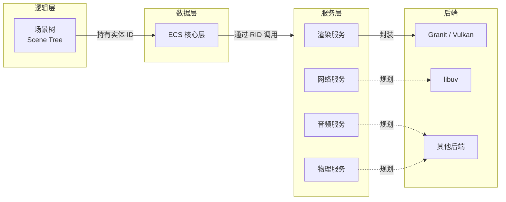

<!-- SPDX-License-Identifier: MIT -->
<!-- Copyright (c) 2026 Gneiss contributors -->

# Gneiss 总体架构

## 当前状态

本文定义 Gneiss 的目标分层和模块边界。项目仍处于早期开发阶段；图中的音频、物理及其他后端属于架构边界，不代表相关功能已经完成。

## 分层关系

### 逻辑层

场景树负责组织游戏对象及其层级关系，为开发者提供直观的场景编辑与运行时管理模型。

### 数据层

ECS 核心层负责实体、组件和系统的数据组织与调度。场景节点持有实体 ID，将易用的层级结构映射到高效的数据布局。

### 服务层

渲染、网络、音频和物理能力按独立服务划分。ECS 通过资源 ID（RID）引用服务管理的资源，避免业务组件直接依赖具体后端对象。

### 后端层

后端层承接平台与第三方库实现。当前渲染后端基于 Granit/Vulkan；网络、音频、物理等后端尚未
实现，将在真实用例和方案确认后记录到对应 ADR 和 Reference。

## 核心技术

| 领域 | 技术或方案 | 当前定位 |
| --- | --- | --- |
| 编程语言 | C++20 | 项目语言标准 |
| 图形 API | Vulkan | 由 Granit 封装 |
| 渲染基础 | Granit | 渲染服务后端 |
| 数据架构 | ECS | 核心运行时数据层 |
| 场景组织 | Scene Tree | 逻辑对象与层级管理 |
| 资源管理 | Service + RID | 服务边界与资源引用 |
| 异步网络 | 尚未选型 | 后续阶段按真实用例决策 |
| 目标平台 | Windows、Linux | 初始平台范围 |

## 边界约束

- 场景树不直接持有后端资源对象，只关联实体 ID。
- ECS 组件保存数据或 RID，不持有后端库的原生句柄。
- 服务负责资源生命周期、有效性校验和后端调用。
- 第三方库类型不应跨越公共服务边界，除非对应 Reference 明确定义。
- 新增跨层依赖前，应通过 ADR 记录背景、选择和影响。

## 资产与场景域所有权

Application 的 `engine::asset_manager` 拥有 VFS 装配副本、`resource_cache`、渲染资产加载器和
Prefab 描述加载器。资产缓存本身位于 asset 层，不反向依赖场景或渲染；具体类型在功能层 `engine/function/asset` 装配。不同 Application 不共享这份状态。

`application_scene_state` 拥有 World 和场景实例服务，借用管理器及其模块内加载器。活动、候选和待退役域
使用同一缓存；各场景实例持有实际版本租约。兼容固定版本可跨域复用，World、实体和节点仍独立。
候选 ready 只准备默认选择事务，成功激活才提交选择；失败或取消释放候选引用，不覆盖旧使用者。

退出时先排空请求，再释放场景实例及 World，最后销毁共享资产状态。渲染资源服务晚于资产租约
销毁；已提交帧另持有不可变资源数据，不依靠场景域存活。运行中会回收无使用者的版本，
不承诺跨所有场景关闭后的长期缓存驻留。

渲染普通获取优先复用兼容配置的已采用版本；未就绪时旧同步接口仍有阻塞兼容路径。
Prefab 准备描述按固定版本共享，但旧 URI 获取仍未完全收敛。共享缓存不等于共享在途准备任务，
也不代表所有描述解析和来源复验都被省略。验收及限制见
[所有权迁移记录](../records/M-331-application-asset-ownership.md)。

资产管理器统一提供类型化 acquire（Mesh、Material、Texture、Prefab）、渲染资产就绪查询、
异步请求通道创建、版本采用及回收。缓存为私有唯一索引；Scene 不再直接操作缓存。
请求通道复用现有渲染资产异步服务，操作拥有通道并先于管理器销毁；场景实例化和编辑提交仍
属于对应协调者。Prefab 的后台描述准备仍由现有准备服务执行，最终版本进入共享 Loader/cache。
当前不是任意类型动态注册的插件系统，也没有新增跨请求准备合并或统一 Scene 资源租约。
