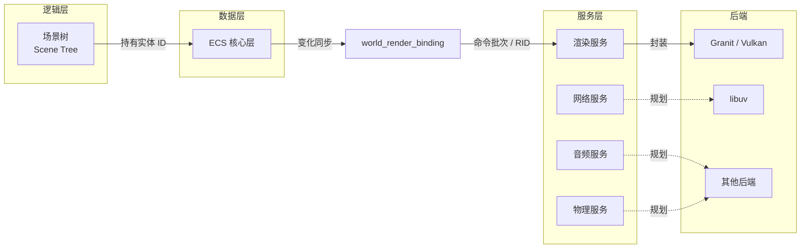

<!-- SPDX-License-Identifier: MIT -->
<!-- Copyright (c) 2026 Gneiss contributors -->

# Gneiss 总体架构

## 当前状态

本文定义 Gneiss 的目标分层和模块边界。项目仍处于早期开发阶段；图中的音频、物理及其他后端属于架构边界，不代表相关功能已经完成。

## 分层关系

### 逻辑层

场景树负责组织游戏对象及其层级关系，为开发者提供直观的场景编辑与运行时管理模型。

### 数据层

ECS 核心层负责实体、组件和系统的数据组织与调度。场景节点持有实体 ID，将易用的层级结构映射到高效的数据布局。

### 服务层

渲染服务管理渲染端对象与后端调用。逻辑组件持有引擎资产强引用，World 侧同步系统将变化转换为
命令批次；RID 用于渲染服务边界，组件不依赖后端对象。网络、音频和物理服务仍是规划边界。

### 后端层

后端层承接平台与第三方库实现。当前渲染后端基于 Granit/Vulkan；网络、音频、物理等后端尚未
实现，将在真实用例和方案确认后记录到对应 ADR 和 Reference。

## 核心技术

| 领域 | 技术或方案 | 当前定位 |
| --- | --- | --- |
| 编程语言 | C++20 | 项目语言标准 |
| 图形 API | Vulkan | 由 Granit 封装 |
| 渲染基础 | Granit | 渲染服务后端 |
| 数据架构 | ECS | 核心运行时数据层 |
| 场景组织 | Scene Tree | 逻辑对象与层级管理 |
| 资源管理 | Service + RID | 服务边界与资源引用 |
| 异步网络 | 尚未选型 | 后续阶段按真实用例决策 |
| 目标平台 | Windows、Linux | 初始平台范围 |

## 边界约束

- 场景树不直接持有后端资源对象，只关联实体 ID。
- ECS 组件保存数据或引擎资产强引用，不持有后端库的原生句柄。
- 服务负责资源生命周期、有效性校验和后端调用。
- 第三方库类型不应跨越公共服务边界，除非对应 Reference 明确定义。
- 新增跨层依赖前，应通过 ADR 记录背景、选择和影响。

## 资产与场景域所有权

Application 的资产管理器位于 engine/function/asset，统一管理 Scene、Prefab 与渲染资产的
弱缓存和在途加载记录，不拥有 World。资产值类型位于 engine/resource，GPU 对象由渲染服务管理。
详细加载与资源生命周期见[资产参考](../reference/assets.md)。

Application 拥有共享服务，宿主持有独立 world_owner 并决定各 World 的更新与暂停；
Runtime/Editor 加载器维护自己的打开、重载和视觉批次。
World 拥有本运行空间的系统 callable，按注册顺序执行，不反向持有 Application。
长期依赖显式注入，每轮接收 frame_time；渲染同步仍属于宿主调度阶段。
具体调用与失败契约见 [World 参考](../reference/world.md#world-系统)。
资产管理器异步取得 Scene/Prefab 后，宿主在所属线程组合并同步实例化，成功后显式卸载旧实例。
World 不持有资产管理器，普通切换不替换 World。结构加载失败保留旧实例。
视觉资源先预留稳定引用，内容随后异步完成；失败记录诊断，可显式重试，不回滚场景。
取消场景切换不回滚已完成的共享资源更新；不提供跨帧构建预算或构建中取消。

渲染资源使用稳定 RID，异步上传成功后逐项替换当前内容，失败项保留旧内容。
已提交帧另持有不可变数据；旧内容按帧和后端生命周期退休。运行时固定版本索引、
默认版本选择表和采用事务已经删除。编辑命令直接提交作者修改，不再提交缓存选择。

退出时先排空任务，再释放场景与 World，最后销毁资产状态。渲染资源服务晚于资源租约销毁。
CPU 数据由准备结果直接持有；Prefab 已解析描述更新统一资源缓存，旧实例继续持有所需描述。
资产记录统一保存弱缓存与在途操作；观察者取消不等于取消其他调用方共享的加载。
弱缓存不保活无使用者资产。

场景提前激活、逐项结果与加载内部收缩的范围和验收见
[资源简化计划](../plans/PLAN-051-progressive-render-assets.md)。
